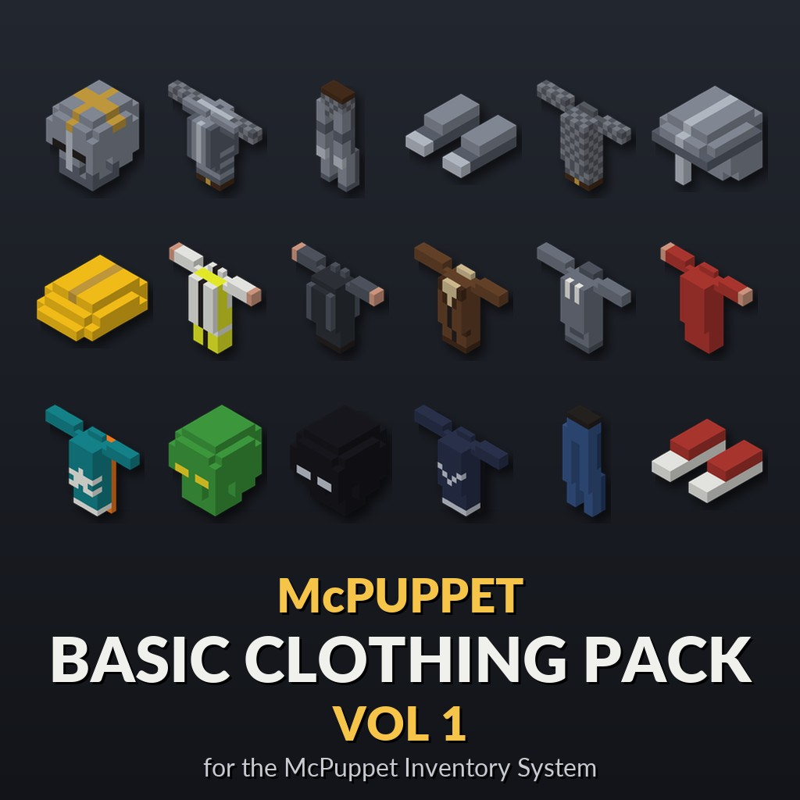

# McPuppet Basic Clothing Pack Vol 1

On the Steam Workshop: [McPuppet Basic Clothing Pack Vol 1](https://steamcommunity.com/sharedfiles/filedetails/?id=3840291332)

**27 pieces of clothing and armour for the McPuppet Inventory System, on any map, in single player and multiplayer.** Put a piece in your inventory's equipment slots and your character wears it, shaped to that character's own build, and every player sees it.

## Required
[**McPuppet Inventory System**](https://steamcommunity.com/sharedfiles/filedetails/?id=3840357667) (listed under Required items; Steam asks you to subscribe to it too). Enable both, then play any map. This pack adds the clothes; the inventory puts them on and does the rest.

## How it works
- With the inventory, everyone starts in their underwear.
- Open the inventory (**I**) and drag a piece onto the **head**, **upper body**, **lower body** or **feet** slot.
- Buy pieces from the inventory's store, or pick them up where they lie: anything you drop stays in the world, and you drop everything when you die.
- Everyone starts with 500 gold, so the better pieces have to be earned: sell what you find to the store.
- Clothes fit every character of the game: tall, short, broad or slim, hair and all.

## Stats
Every piece has its numbers, shown when you point at it in the inventory:
- **Defense**: the share of every hit it blocks (pieces add up: full plate blocks most of a blow).
- **Mobility**: walking speed and jump height on land. Heavy armour slows you down; sneakers and the hero suits make you quicker.
- **Swim**: speed in water instead. Metal armour drags you down: a full plate set swims at a crawl, chain mail slowly.
- **Noise**: how loud you move, for mods whose creatures listen. Plate clanks, sneakers are quiet.

## What's in it
- **Everyday**: T-shirt, leather jacket, hoodie, jeans, shorts, leather boots, sneakers.
- **Work**: hard hat, hi-vis vest.
- **Combat**: steel helmet, tactical vest.
- **Medieval**: chain mail, plate armour, plate legs, sabatons, great helm.
- **Hero costumes**: Night Watch (hood, suit, tights, boots), Captain Comet (suit, tights, boots) and Gecko (mask, suit, tights, boots).

## Multiplayer
The host enables the inventory and this pack under Global mods; everyone downloads them when joining. Everyone sees what everyone wears.

## More
Weapons to go with it: **McPuppet Basic Melee Weapons Pack Vol 1**. Want to make your own clothing pack? The inventory mod's folder has a short guide (MODDING_CLOTHING.md) and an example pack: one small file per piece.

## Community

Join the [Discord community](https://discord.gg/gNpRewdkxf) to post bug reports and suggestions.

## Install

Subscribe on the [Steam Workshop](https://steamcommunity.com/sharedfiles/filedetails/?id=3840291332), or clone this repository into
`Documents/Teardown/mods/basic clothing pack vol 1`. Enable it under **Global mods** (in multiplayer the host does).

## Credits

Made by AgeOfAlgorithms and Claude (Anthropic). MIT licence.
